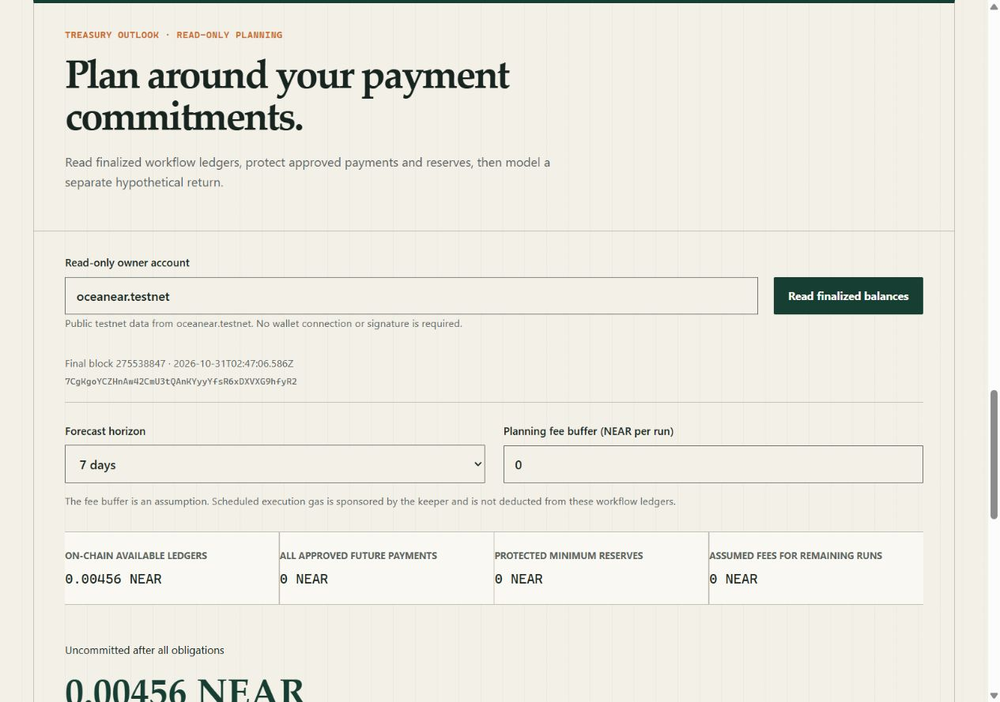

<div align="center">


# Auvora Finance

**Recurring NEAR payments with a treasury reserve**

Set a recipient, payment amount, schedule, and minimum reserve. Sign the policy in your testnet wallet, then follow each scheduled payment from the dashboard to its on-chain receipt.




[Features](#features) · [How it works](#how-it-works) · [Testnet evidence](#testnet-evidence) · [Quick start](#quick-start)

</div>

---

## Problem

A treasury that pays the same recipient every week has two jobs on each due date. Someone has to send the payment and check that enough funds will remain for other obligations.

## Solution

Auvora lets the owner authorize a recurring payment once. A keeper requests each due run, and the NEAR contract checks the signed terms and available balance before releasing funds. The owner can pause the schedule or cancel future runs from the dashboard.

Built for the **NEAR Hackathon 2026**. The MVP handles native NEAR on testnet. It is unaudited.

## Features

| Feature              | What you can do                                                                                                                                                                                                   |
| -------------------- | ----------------------------------------------------------------------------------------------------------------------------------------------------------------------------------------------------------------- |
| Payment builder      | Enter an instruction, select **Fill payment fields**, then review the recipient, amount, interval, run limit, and reserve before signing. The optional NEAR AI Cloud adapter falls back to deterministic parsing. |
| Workflow management  | Authorize a recipient, create and fund a workflow, then pause, resume, cancel, or withdraw the amount the contract makes available.                                                                               |
| Sponsored management | Sign a delegate for an eligible management action. The relayer pays for the outer transaction. The owner funds workflow creation.                                                                                 |
| Treasury outlook     | Enter a public testnet account to forecast commitments and funding gaps from one finalized block. Model a hypothetical annual return by adjusting principal and APY.                                              |
| Execution record     | Inspect keeper-recorded attempts and check their hashes against finalized RPC outcomes and contract events. Unresolved attempts appear as pending or unverified.                                                  |
| Wallet recovery      | After a reload, reconnect the same owner and check a saved transaction hash. If the wallet closed before returning a hash, review wallet activity before retrying.                                                |

---

## How it works

1. **Draft and approve.** The owner reviews the payment fields, authorizes the recipient, and signs the funded workflow in a NEAR testnet wallet.
2. **Request a due run.** The keeper discovers the workflow and calls `execute_due` with its ID. The contract reads the recipient and amount from the stored policy and checks the schedule, remaining runs, reserve, and pending slot.
3. **Settle the payment.** The contract dispatches the transfer and records its outcome in a callback. A failed transfer restores the reserved ledger amount. After a keeper restart, the worker reconciles its saved transaction hash.
4. **Inspect the result.** Enter the owner's account in **Execution record** to see attempts tracked by the keeper. External transactions can fall outside this index.

For a guided walkthrough with wallet steps and expected results, follow the [demo runbook](docs/DEMO_RUNBOOK.md).

## Testnet evidence

| Recorded result                                                                                                 | Evidence                                                                                                  |
| --------------------------------------------------------------------------------------------------------------- | --------------------------------------------------------------------------------------------------------- |
| Treasury contract deployed at `oceanear.testnet`                                                                | [Deployment transaction](https://testnet.nearblocks.io/txns/FW1uXWCowcW1W17HUUryk965Rgzrn5h6x3e9tgjiimX1) |
| Workflows 2 and 4 each completed two payments of 0.001 NEAR. Workflows 3 and 5 reached the reserve guard.       | [Payment and reserve report](docs/phase-7/2026-10-30-final-report.json)                                   |
| A restarted worker recovered its transaction hash. Two keeper processes produced one payment for the next slot. | [Keeper process report](docs/phase-7/2026-10-30-process-final-report.json)                                |
| Workflow 11 completed sponsored pause, resume, cancel, and withdrawal with final receipts.                      | [Transactions and contract events](docs/phase-12/2026-11-03-sponsored-acceptance.md)                      |

The NEAR AI Cloud adapter still needs live verification. Remaining acceptance checks cover wallet redirects, device coverage, live contract edge cases, and owner/relayer balance changes. [Live acceptance checklist](docs/phase-12/LIVE_ACCEPTANCE.md)

---

## Architecture and tech stack

| Component                               | Implementation             | Role                                                                                              |
| --------------------------------------- | -------------------------- | ------------------------------------------------------------------------------------------------- |
| [Web app](apps/web)                     | Next.js, React, TypeScript | Builds payment policies, connects wallets, and displays treasury forecasts and execution history. |
| [Treasury contract](contracts/treasury) | Rust on NEAR               | Enforces payment policies and accounts for transfers, reserves, and withdrawals.                  |
| [Keeper](apps/keeper)                   | Node.js, PostgreSQL        | Discovers due workflows and persists signed transactions before broadcast.                        |
| [Relayer](apps/relayer)                 | Node.js, NEP-366 delegates | Validates owner-signed management requests, reserves a sponsorship budget, and submits them.      |
| [Shared packages](packages)             | TypeScript, Prisma         | Provide workflow schemas, treasury calculations, NEAR RPC clients, and database access.           |

---

## Quick start

### Prerequisites

- Node.js 22.12 or newer within 22.x (tested with 22.22.1)
- Corepack with pnpm 12.14.0
- Rust 1.99.1 with `rustfmt`, `clippy`, and `wasm32-unknown-unknown`
- `cargo-near` 0.22.0
- PostgreSQL for the keeper evidence store
- Linux, WSL2, or Ubuntu CI for the `near-workspaces` sandbox test
- A NEAR testnet wallet only when performing the human-signed demo path

```bash
corepack enable
corepack prepare pnpm@12.14.0 --activate
pnpm install --frozen-lockfile
rustup show
cargo install --locked cargo-near --version 0.22.0
```

### Configuration

Use [.env.example](.env.example) as the field list. Keep credentials only in ignored local files or deployment secret stores:

- `apps/web/.env.local`: web configuration, including server-only history and optional AI settings.
- `.env.keeper.local`: restricted keeper account and database configuration.
- `.env.relayer.local`: separately funded relayer configuration.
- `.env.deploy.local`: owner deployment credentials for an explicitly approved deployment or upgrade.

Never paste a seed phrase into the app. Never commit a private key or AI provider key.

In `apps/web/.env.local`, configure the testnet endpoint and contract. To enable execution history, also set the server-only `AUVORA_HISTORY_DATABASE_URL` to the keeper PostgreSQL database using a read-only role.

```dotenv
NEXT_PUBLIC_NEAR_RPC_URL=https://test.rpc.fastnear.com
NEXT_PUBLIC_AUVORA_CONTRACT_ID=oceanear.testnet
```

Optional AI provider configuration:

```dotenv
AI_PROVIDER=near-ai
NEAR_AI_BASE_URL=https://cloud-api.near.ai
NEAR_AI_API_KEY=
AI_MODEL=
AI_TIMEOUT_MS=8000
```

If the provider key or model is absent, the web app keeps the manual form available and uses the deterministic parser for supported instructions.

### Run locally

Start the dashboard from the repository root and open [the local dashboard](http://localhost:3000/dashboard).

```bash
pnpm --filter @auvora/web dev
```

Keeper, after the database migration and restricted-key setup:

```bash
pnpm db:migrate:deploy
pnpm keeper:dev
```

Sponsored management, after configuring the relayer account and the same database in `.env.relayer.local`:

```bash
pnpm relayer:migrate
pnpm relayer:dev
```

Set `NEXT_PUBLIC_SPONSOR_URL=http://127.0.0.1:3002` in `apps/web/.env.local`, then restart the web server. The browser requests one NEP-366 delegate for pause, resume, cancel, or an exact contract-reported withdrawal. The relayer validates the signed payload, stores the relayer transaction and budget reservation before broadcast, reconciles the same hash after uncertain RPC responses, and never sponsors workflow creation or funding.

The keeper exposes `/live` and `/ready` on port `3001` by default. It persists signed transaction bytes and the derived hash before broadcast, then reconciles that same hash after restart or an uncertain RPC response.

Read-only evidence report:

```bash
pnpm proof:report
```

The report reads final contract views plus the keeper's transaction records. It never imports a wallet key into the browser and never submits a transaction.

It independently verifies recorded execution hashes with final RPC outcomes and contract-origin events. Use `pnpm proof:report --chain-only` without database access, or `pnpm proof:report --require-evidence` to fail when the payment-and-reserve evidence is incomplete. Neither command certifies all MVP release gates.

`pnpm proof:payments` previews the two signed Phase 7 fixtures without sending transactions. After human approval, `pnpm proof:payments --execute` runs the scheduled payments, reserve rejection, persisted-hash recovery, and concurrent keeper cycles, then withdraws remaining fixture balances. Read the accounts, testnet deposits, limitations, and recovery instructions in the [Demo runbook](docs/DEMO_RUNBOOK.md) first.

### Check local readiness

Run the read-only local doctor before testing a payment:

```bash
pnpm local:doctor
```

The default web URL is `http://127.0.0.1:3000`. For the existing production preview, use:

```bash
pnpm local:doctor --web-url http://127.0.0.1:3010
```

Use `--offline` to check local configuration without network requests, or `--json` for a machine-readable report. Exit code 0 means the requested checks passed, 1 means a readiness blocker, and 2 means invalid options or an internal failure. Offline success does not certify running services.

The doctor checks ignored environment files, supported Node, configuration alignment, the local web page, keeper polling health, RPC testnet identity, finalized contract status, and the keeper key's on-chain method/receiver restriction and remaining allowance. Output omits secrets and raw RPC errors. It does not start services, migrate the database, sign, provision keys, or send transactions. A passing result is not proof of a completed payment or real wallet acceptance. The name `local:doctor` avoids pnpm's built-in `doctor` command.

Keeper health now includes `healthVersion: 1` and its public network, contract, signer, and instance identity. The doctor compares those reported values with `.env.keeper.local`; restart an older keeper before using the updated doctor. `/live` remains HTTP 200 while the service runs. `/ready` returns HTTP 503 before the first successful cycle, after a failure, or when the last successful poll is stale or in the future. Starting a retry does not clear a failure; a successful cycle must persist its database heartbeat first. Both endpoints use `Cache-Control: no-store`. Reported identity is a consistency check, not cryptographic attestation.

If the keeper check fails, confirm PostgreSQL is available, then run the migration and keeper commands from **Run locally**. If the web check fails, start the web app or specify the correct local port. After changing public web configuration, restart development mode or rebuild production mode.

### Validation commands

```bash
pnpm format:check
pnpm lint
pnpm typecheck
pnpm test
pnpm build
pnpm audit --audit-level high
cargo fmt --all --check
cargo clippy --workspace --all-targets -- -D warnings
cargo test --workspace --locked
cargo audit
cd contracts/treasury
cargo near build non-reproducible-wasm --locked
```

Native Windows supports the TypeScript checks and Rust unit tests. Run the sandbox integration test on Linux, WSL2, or Ubuntu CI.

---

## Documentation

- [Demo runbook](docs/DEMO_RUNBOOK.md) and [recorded evidence](docs/DEMO_EVIDENCE.md)
- [Contract interface](docs/phase-1/CONTRACT_INTERFACE.md) and [security model](docs/SECURITY.md)
- [Known limitations](docs/KNOWN_LIMITATIONS.md) and [release checklist](docs/RELEASE_CHECKLIST.md)

<div align="center">

**Auvora Finance** · NEAR Hackathon 2026

</div>
